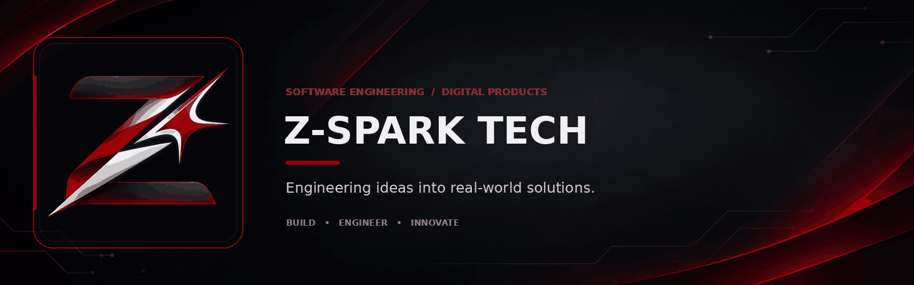

<div align="center">

  <!-- Official Organization Animated Banner -->
  <a href="https://zspark.sewedy.com.eg" target="_blank" rel="noopener noreferrer">
    
  </a>

  <br /><br />

  <p align="center">
    <strong>SOFTWARE ENGINEERING &nbsp;·&nbsp; DIGITAL PRODUCTS &nbsp;·&nbsp; ENTERPRISE SYSTEMS</strong>
  </p>

  <p align="center">
    <em>Think Beyond. Build Better. Spark Innovation.</em>
  </p>

  <!-- Navigation Badges -->
  <p align="center">
    <a href="https://zspark.sewedy.com.eg" target="_blank" rel="noopener noreferrer">
      
    </a>
    &nbsp;
    <a href="https://github.com/Z-Spark-Tech" target="_blank" rel="noopener noreferrer">
      
    </a>
    &nbsp;
    <a href="#4-our-products--solutions">
      
    </a>
    &nbsp;
    <a href="#6-technologies--engineering-ecosystem">
      
    </a>
  </p>

</div>

---

## 1. Organization Background

**Z-Spark Tech** is a software engineering and technology organization based in Egypt. We bring together developers, software engineers, and technology enthusiasts dedicated to designing, developing, and maintaining high-impact digital products and software systems that solve real-world operational challenges.

Our work spans multiple engineering disciplines, encompassing web and mobile applications, resilient backend architectures, enterprise operational systems, educational technology platforms, centralized authentication services, and software infrastructure.

At Z-Spark Tech, our engineering focus extends beyond writing code. We believe in deeply understanding domain problems, architecting robust and maintainable solutions, delivering dependable production systems, and continuously advancing our engineering practices.

> **Our Identity:**  
> **Think Beyond. Build Better. Spark Innovation.**

### Our Mission
To engineer meaningful digital solutions that solve real-world problems, streamline organizational operations, and create sustained long-term value through technology.

### Our Vision
To become a recognized technology organization known for engineering excellence, innovative products, reliable software systems, and impactful digital solutions across Egypt and the broader technology ecosystem.

---

## 2. About Us

Z-Spark Tech was founded on the principle that software should be purposeful, resilient, and built to solve tangible operational bottlenecks. In many institutional and operational environments, workflows are fractured across disconnected spreadsheets, paper-based tracking, and disparate tools. This fragmentation introduces data inconsistencies, operational friction, and administrative overhead.

We address these challenges by architecting unified, role-aware software platforms tailored to institutional requirements. By standardizing shared identities, centralized data models, and automated workflows, our systems bridge communication gaps between end users, team leads, and executive administration.

### Our Core Commitments

- **Innovation with Intent:** We explore emerging technologies and modern frameworks not for novelty, but to solve real problems more effectively and reliably.
- **Engineering Excellence:** We emphasize clean code, solid architectural design, strict separation of concerns, and maintainable development standards.
- **Collaboration & Growth:** We foster an environment of knowledge sharing, transparent peer reviews, collective problem-solving, and continuous technical evolution.
- **Reliability & Security:** We treat data integrity, role-based authorization, operational performance, and auditability as foundational requirements, not afterthoughts.

---

## 3. What We Do

Our technical expertise and development activities are structured across seven core engineering areas:

### Web Application Development
We design and build modern, responsive, and scalable web applications and digital platforms. Utilizing modern frontend frameworks such as React and Next.js alongside component design systems, we deliver responsive user interfaces optimized for usability, performance, and accessibility across devices.

### Backend Engineering
We develop high-throughput, secure, and maintainable backend services and RESTful APIs using ASP.NET Core and .NET. Our backend systems implement clean architectural patterns, robust data validation, transactional integrity, relational database modeling with Entity Framework Core and SQL Server, and secure data access layers.

### Mobile Application Development
We build practical, user-centric mobile applications using cross-platform frameworks including Flutter and Dart. Our mobile solutions integrate with backend REST APIs, support offline caching, secure local storage, and provide responsive workflows tailored to mobile users.

### Enterprise & Management Systems
We engineer operational and administrative platforms that streamline organizational processes, automate business workflows, and enhance team productivity. These systems include administrative dashboards, bulk data migration utilities, device and maintenance ticketing systems, and organizational oversight platforms.

### Education Technology
We develop comprehensive digital education platforms, including learning management systems (LMS), computer-based examination hubs, admissions management portals, attendance tracking systems, and practical competency assessment platforms tailored for schools and technical academies.

### Authentication & System Integration
We build centralized identity providers, Single Sign-On (SSO) systems, and cross-application integration pipelines. By establishing token-based authentication boundaries (JWT) and multi-entity authorization rules, we enable diverse sub-systems to interact securely while keeping identity management decoupled from individual applications.

### Software Infrastructure
We oversee the deployment, hosting, performance optimization, and reliability of our applications. Our infrastructure workflows leverage Docker containerization, Internet Information Services (IIS), CI/CD automation through GitHub Actions, and database backup and migration strategies.

---

## 4. Our Products & Solutions

Z-Spark Tech has designed, developed, and maintained fifteen specialized software products and systems. These solutions address critical challenges across academic management, institutional operations, enterprise ticketing, and digital platforms.

```
┌────────────────────────────────────────────────────────────────────────┐
│                        Z-SPARK TECH ECOSYSTEM                          │
├──────────────────────────┬─────────────────────────────┬───────────────┤
│  Education & Academic    │  Enterprise & Operations    │  Products &   │
│  Technology              │  Systems                    │  Experiences  │
├──────────────────────────┼─────────────────────────────┼───────────────┤
│ • Capstone               │ • AdminHub                  │ • Al-Qady     │
│ • GenZCoders             │ • Employee Attendance (RMS) │ • UI Gallery  │
│ • Elsewedy Portfolio     │ • TicTrack                  │ • Z-Spark     │
│ • Attendance             │ • CAS-Login                 │   Portfolio   │
│ • Admission-System       │                             │               │
│ • Exam-Hub               │                             │               │
│ • Assessment             │                             │               │
│ • SUE (Student Union)    │                             │               │
└──────────────────────────┴─────────────────────────────┴───────────────┘
```

---

### Category A: Education & Academic Technology

#### 1. Capstone
* **Overview:** A centralized web-based management platform designed to coordinate student graduation and capstone projects across academic cohorts.
* **Purpose:** Solves the visibility and accountability challenges in large-scale capstone programs by connecting students, engineers, team leads, and administrators within a structured submission and review workflow.
* **Key Capabilities:**
  * Multi-tier lifecycle tracking across task stages (`Pending` → `In Progress` → `Submitted` → `Approved` / `Rejected`).
  * Hierarchical task assignment targeting grade levels, class groups, or specific project teams.
  * Deliverable submission workflows supporting milestone documentation, notes, and external repository tracking.
  * Interactive project progress dashboards and administrative review analytics powered by Chart.js.
* **Technology Stack:** React 18, Tailwind CSS, Chart.js, ASP.NET Core 8 Web API, Entity Framework Core, Microsoft SQL Server, JWT Authentication, BCrypt.
* **Category:** Education & Academic Technology

#### 2. GenZCoders
* **Overview:** A dedicated learning and curriculum delivery platform orchestrating technical training cohorts, programming tracks, and assignment lifecycles.
* **Purpose:** Bridges course management, student progress tracking, and practical assignment review into a single educational workspace rather than disconnected communication channels.
* **Key Capabilities:**
  * Course catalog and training round lifecycle management with cohort enrollment tracking.
  * Hierarchical task and parent-task delivery with deadline-aware submission tracking.
  * Instructor review workflows with student resubmission handling and milestone tracking.
  * Role-specific dashboards for learners, instructors, and training administrators.
* **Technology Stack:** React, Vite, Material-UI, Tailwind CSS, ASP.NET Core Web API, Entity Framework Core, Microsoft SQL Server, RESTful APIs.
* **Category:** Education & Academic Technology

#### 3. Elsewedy Portfolio
* **Overview:** The official institutional web portal and academic showcase for Elsewedy International Applied Technology School (IATS).
* **Purpose:** Communicates the school's educational vision, academic specializations, state-of-the-art facilities, and competitive achievements to prospective students, partners, and the educational community.
* **Key Capabilities:**
  * Comprehensive presentation of specialized tracks including Software Programming, Integrated Systems, and Fab Lab operations.
  * Showcase for student competitive achievements in ICPC and national engineering competitions.
  * Responsive single-page architecture optimized for fast load times and clean presentation across desktop and mobile devices.
  * Bilingual-ready typography featuring Cairo and Inter font hierarchies.
* **Technology Stack:** React, Vite, Tailwind CSS, Modern Responsive Web Architecture.
* **Category:** Education & Academic Technology

#### 4. Attendance
* **Overview:** A high-throughput daily student attendance and absence tracking system anchored directly to official institutional enrollment lists.
* **Purpose:** Eliminates attendance discrepancies and stale spreadsheet records by ensuring daily session attendance is recorded against a synchronized student identity.
* **Key Capabilities:**
  * Session-by-session and class-based daily attendance recording with exception management.
  * Automated absence reporting, trend tracking, and multi-format Excel exports.
  * Progressive Web App (PWA) support with service worker integration for classroom and offline reliability.
  * Web Push notifications powered by Firebase Admin SDK and VAPID protocol.
* **Technology Stack:** React, Vite, ASP.NET Core 8 Web API, Entity Framework Core, Microsoft SQL Server, Firebase Admin SDK, Service Workers (PWA), IIS.
* **Category:** Education & Academic Technology

#### 5. Admission-System
* **Overview:** An end-to-end applicant intake, examination, and admissions management platform designed for technical academies.
* **Purpose:** Digitizes the complete applicant journey from initial registration through entrance examinations to final enrollment, ensuring institutional data integrity.
* **Key Capabilities:**
  * Multi-step digital applicant registration and document submission portal.
  * Secure, timed online entrance examination module featuring automated progress persistence.
  * Integrated evaluation interface for scoring physical interviews and committee reviews.
  * Admissions analytics and enrollment trend visualization powered by Recharts.
* **Technology Stack:** React 19, Vite, Tailwind CSS 4.0, React Router DOM 7, Recharts, Lucide React, ASP.NET Core 8 Web API, Entity Framework Core, Microsoft SQL Server, JWT.
* **Category:** Education & Academic Technology

#### 6. Exam-Hub
* **Overview:** A comprehensive academic assessment platform for creating, scheduling, delivering, and evaluating computer-based examinations.
* **Purpose:** Provides a dependable testing environment that centralizes question authoring, enforces examination timing, and automates result generation while maintaining academic integrity.
* **Key Capabilities:**
  * Question bank management supporting diverse question types and ClosedXML Excel bulk import templates.
  * Secure student examination sitting interface featuring rich-text sanitization via DOMPurify.
  * Automated grading pipelines with instant score tabulation and ExcelJS analytical report generation.
  * Seamless integration with Central Authentication Service (CAS) for single sign-on access.
* **Technology Stack:** React, Vite, Axios, DOMPurify, ExcelJS, ASP.NET Core .NET 9 Web API, Entity Framework Core, Microsoft SQL Server, JWT, ClosedXML.
* **Category:** Education & Academic Technology

#### 7. Assessment
* **Overview:** An enterprise competency assessment and quality verification platform developed for technical academies and vocational training programs.
* **Purpose:** Standardizes the practical evaluation of technical competencies through a structured multi-role audit trail that ensures grading fairness and quality verification.
* **Key Capabilities:**
  * Three-role governance workflow (`Control`, `Assessor`, `Verifier`) providing strict separation of assessment responsibilities.
  * Multi-attempt task tracking (Attempts A through D) with detailed rubric scoring and assessor notes.
  * Formal verification and approval pipeline preventing unreviewed grade finalization.
  * Automated performance analytics and competency completion reporting across cohorts.
* **Technology Stack:** Next.js 16 (App Router with Turbopack), React 19, Radix UI Primitives, Lucide Icons, Tailwind CSS, Next Themes, ASP.NET Core Web API (.NET 10), Entity Framework Core 10, Microsoft SQL Server.
* **Category:** Education & Academic Technology

#### 8. SUE — Student Union Election
* **Overview:** A real-time digital balloting and election management system built for student union and organizational elections.
* **Purpose:** Replaces manual paper ballots with a transparent, auditable, and instant digital election platform that guarantees one-person-one-vote integrity.
* **Key Capabilities:**
  * Authenticated ballot submission with strict single-vote verification and session protection.
  * Real-time live vote counting and instant leaderboard streaming powered by ASP.NET Core SignalR hubs.
  * Candidate profile management, electoral slate organization, and election parameter controls.
  * Detailed audit logs for electoral verification, turnout monitoring, and post-election reporting.
* **Technology Stack:** React 18, Vite, React Router DOM, `@microsoft/signalr`, Axios, ASP.NET Core 8 Web API, Entity Framework Core, Microsoft SQL Server, SignalR, BCrypt, JWT Bearer.
* **Category:** Education & Academic Technology

---

### Category B: Enterprise & Operational Systems

#### 9. AdminHub
* **Overview:** The central administrative command dashboard for institutional operations, managing students, accounts, roles, and academic class assignments.
* **Purpose:** Unifies student lifecycle administration, user credential governance, and operational transfers into a single validated control center.
* **Key Capabilities:**
  * Comprehensive student record search, status filtering, and individual or multi-select transfer workflows.
  * High-performance bulk class transfer module powered by ClosedXML with input validation and error reporting.
  * Account and role governance with duplicate phone/email detection and dual password compatibility (standard and bcrypt).
  * Class-level transfer constraint validation and automated team assignment synchronization.
* **Technology Stack:** React, Vite, JavaScript, CSS Design System, .NET 8 ASP.NET Core Web API, Entity Framework Core, Microsoft SQL Server, JWT Authentication, ClosedXML.
* **Category:** Enterprise & Operational Systems

#### 10. Employee Attendance (RMS)
* **Overview:** An enterprise employee attendance and leave management system built for staff presence monitoring and formal leave administration.
* **Purpose:** Streamlines employee time tracking, vacation requests, and HR governance while replacing manual paper requests with an automated approval workflow.
* **Key Capabilities:**
  * Employee leave balance tracking across annual, casual, and medical leave categories.
  * Structured multi-tier leave request, review, and approval lifecycle for department supervisors and HR.
  * Automated attendance calculations and monthly working day summaries.
  * Administrative HR dashboard for institutional staffing oversight and leave history audits.
* **Technology Stack:** React, Vite, Tailwind CSS, ASP.NET Core Web API, Entity Framework Core, Microsoft SQL Server, Azure Identity / JWT.
* **Category:** Enterprise & Operational Systems

#### 11. TicTrack
* **Overview:** An IT support and device maintenance ticketing portal engineered for managing hardware repairs and equipment servicing.
* **Purpose:** Resolves organizational hardware maintenance challenges by tracking equipment faults, repair progress, and technical resolution across institutional hardware assets.
* **Key Capabilities:**
  * End-to-end device support ticket lifecycle tracking from intake to diagnostic resolution and handover.
  * Role-based triage interface for IT technicians, department administrators, and equipment custodians.
  * Status monitoring, technician assignment, priority flags, and repair history documentation.
  * Modern, responsive interface with system dark/light theme switching.
* **Technology Stack:** Next.js (Turbopack, App Router), React, Tailwind CSS, Lucide Icons, ASP.NET Core 9 Web API, Entity Framework Core, OpenAPI / Swagger.
* **Category:** Enterprise & Operational Systems

#### 12. CAS-Login
* **Overview:** The Central Authentication Service (CAS) providing Single Sign-On (SSO) and identity management across the Z-Spark software ecosystem.
* **Purpose:** Decouples identity and authentication concerns from individual applications, offering users a single login boundary and enforcing unified security policies.
* **Key Capabilities:**
  * Single Sign-On (SSO) gateway coordinating authentication for connected clients (Exam-Hub, Capstone, AdminHub, etc.).
  * Multi-entity token distribution issuing central `cas_sso_token` credentials and application-specific scoped JWTs.
  * Centralized credential store with BCrypt password hashing and origin-validated redirection handshakes.
  * Role and business-entity context resolution embedded directly into downstream application tokens.
* **Technology Stack:** React, Vite, ASP.NET Core Web API, Entity Framework Core, Microsoft SQL Server, JWT Bearer Tokens, BCrypt.
* **Category:** Enterprise & Operational Systems

---

### Category C: Products & Digital Experiences

#### 13. Al-Qady
* **Overview:** An automated competitive programming judge system and contest management platform designed for algorithmic competitions and technical assessments.
* **Purpose:** Delivers real-time, tamper-resistant code compilation and sandboxed testing for programming contests and technical evaluations.
* **Key Capabilities:**
  * Automated judging pipeline supporting multi-language compilation (C++ and modern runtimes) with pass/fail validation.
  * Problem package import engine supporting legacy ICPC, Kattis, and Codeforces formats with hidden test verification.
  * Real-time contest scoreboard calculations, penalty tracking, and time-enforced competition windows.
  * Workstation lockdown and proctoring agent (`AlQady.DeviceAgent`) for secure on-site contest environments.
* **Technology Stack:** ASP.NET Core 8 Web API, React 19, TypeScript, Microsoft SQL Server, Debian-based Judge Adapter (DMOJ backend engine), .NET 8 Device Agent (`AlQady.DeviceAgent`).
* **Category:** Products & Digital Experiences

#### 14. UI Gallery
* **Overview:** A centralized design system showcase and interactive UI component gallery engineering the visual building blocks of Z-Spark products.
* **Purpose:** Promotes user interface consistency, accessible interaction patterns, and reusable frontend architecture across our web applications.
* **Key Capabilities:**
  * Interactive component catalog demonstrating board patterns, interactive widgets, and layout primitives.
  * Advanced data grid configurations and column management powered by AG-Grid and TanStack Table.
  * Fluid drag-and-drop workflows utilizing `@dnd-kit` primitives.
  * Rich data visualization examples and fluid micro-interactions built with Framer Motion and Recharts.
* **Technology Stack:** Next.js 16, React 19, TypeScript, Tailwind CSS 4, Framer Motion, AG-Grid React, TanStack Table, `@dnd-kit`, Recharts, Lucide React.
* **Category:** Products & Digital Experiences

#### 15. Z-Spark Portfolio
* **Overview:** The flagship corporate digital platform and interactive ecosystem portal representing Z-Spark Tech.
* **Purpose:** Serves as the central public-facing hub communicating our corporate identity, engineering capabilities, architectural standards, and active software ecosystem.
* **Key Capabilities:**
  * Interactive system catalog and slug-based architectural showcases with cross-system relationship maps.
  * Real-world usage metrics, institutional implementation narratives, and technical stack explorers.
  * Fluid responsive interface featuring Framer Motion transitions and dark-mode aesthetics.
  * Integrated system inquiry and collaboration contact system.
* **Technology Stack:** Next.js 16 (App Router), React 19, TypeScript, Tailwind CSS 4, Motion (`motion` / Framer Motion), Lucide React.
* **Category:** Products & Digital Experiences

---

## 5. Intellectual Property & Source Code Protection

Z-Spark Tech designs, builds, and maintains proprietary software platforms, administrative tools, and internal infrastructure. To protect our intellectual property, institutional client data, and system security, we adhere to the following governance principles:

- **Private Repositories by Default:** Most organizational development repositories remain strictly private. Repositories are not made public simply for external display.
- **Protection of Proprietary Logic:** Core algorithmic workflows, private database schemas, judging or scoring heuristics, and proprietary business rules are preserved within private codebases.
- **Zero Credential Exposure:** Public documentation and profiles never include credentials, API keys, connection strings, private server endpoints, or internal environment configurations.
- **Transparent Capability Communication:** We communicate our engineering maturity through clear, accurate technical descriptions of what we build, the problems our products solve, and the technologies we employ—without exposing internal proprietary source code.

---

## 6. Technologies & Engineering Ecosystem

The technologies below represent tools, languages, frameworks, and database engines verified through inspection of active Z-Spark Tech codebases and production projects:

```text
Backend Engineering     ::  C#  |  .NET 8 / 9 / 10  |  ASP.NET Core Web API  |  Entity Framework Core
                            RESTful APIs  |  SignalR (Real-time WebSockets)  |  ClosedXML  |  JWT Bearer
Frontend Engineering    ::  React 18 / 19  |  Next.js 16 (App Router)  |  TypeScript  |  JavaScript
                            Tailwind CSS (v3 / v4)  |  Vite  |  Material-UI  |  Framer Motion  |  Recharts
Mobile Development      ::  Flutter  |  Dart  |  Cross-Platform Mobile Architecture
Database & Storage      ::  Microsoft SQL Server  |  Relational Database Modeling  |  SQL Migrations
DevOps & Infrastructure ::  Docker  |  Git  |  GitHub Actions  |  IIS (Internet Information Services)
Testing & Security      ::  xUnit  |  BCrypt Password Hashing  |  Role-Based Access Control (RBAC)  |  DOMPurify
```

### Technology Matrix by Discipline

| Domain | Verified Core Technologies | Representative Projects |
|---|---|---|
| **Backend & APIs** | C#, .NET 8 / 9 / 10, ASP.NET Core, EF Core | Capstone, AdminHub, Exam-Hub, SUE, Al-Qady, Assessment |
| **Frontend Applications** | React, Next.js, TypeScript, Vite, Tailwind CSS | UI Gallery, Z-Spark Portfolio, Admission-System, TicTrack |
| **Real-time Services** | ASP.NET Core SignalR, WebSockets, Firebase | SUE — Student Union Election, Attendance |
| **Data & Persistence** | Microsoft SQL Server, Entity Framework Core | AdminHub, CAS-Login, Exam-Hub, Capstone, Attendance |
| **Identity & Security** | JWT Bearer Tokens, BCrypt, RBAC, CAS SSO | CAS-Login, Admission-System, Capstone, Exam-Hub |
| **Data Exchange & Reports** | ClosedXML, ExcelJS, EPPlus, Recharts, Chart.js | AdminHub, Exam-Hub, Capstone, Attendance |

---

## 7. Our Engineering Standards

Our engineering practices prioritize stability, clarity, and security over short-term expediency:

* **Clean & Maintainable Code:** We prioritize clean code principles, strong typing, meaningful naming, and modular separation of concerns to ensure systems remain easy to understand, test, and maintain over time.
* **Layered Architecture:** Our backend applications consistently separate API controllers, service and business logic layers, data repositories, and data transfer objects (DTOs), preventing coupling between domain rules and persistence mechanisms.
* **Security & Access Control:** We apply defense-in-depth principles across all systems. User passwords are encrypted using verified cryptographic algorithms (such as BCrypt); APIs enforce role-based access control (RBAC) with JWT tokens; user inputs are strictly validated and sanitized to guard against injection and cross-site scripting vulnerabilities.
* **Data Integrity & Schema Discipline:** We manage database schemas through structured, versioned migration scripts and Entity Framework Core migrations, guaranteeing deterministic schema evolution across development, testing, and production environments.
* **Collaborative Code Review:** Code changes undergo peer review to verify architectural alignment, catch potential edge cases, ensure coding convention conformance, and foster shared codebase ownership.
* **Automated Quality Checks:** Critical backend workflows and unit tests are validated using automated test frameworks (xUnit) and continuous integration pipelines to catch regressions before deployment.
* **Living Documentation:** System architectures, API endpoints, integration contracts, and operational requirements are documented alongside the code, ensuring smooth developer onboarding and clear service boundaries.
* **Continuous Technical Learning:** We actively refine our engineering capabilities, modernizing frameworks (e.g., advancing to .NET 8/9/10, React 19, and Next.js 16) and evaluating emerging software patterns to address growing organizational needs.

---

## 8. Our Development Approach

We adhere to a structured, iterative software development lifecycle tailored to delivering dependable, domain-specific products:

```
┌─────────────────┐     ┌─────────────────┐     ┌─────────────────┐
│  1. Understand  │ ──> │    2. Design    │ ──> │   3. Engineer   │
│  & Specify      │     │  & Architect    │     │  & Implement    │
└─────────────────┘     └─────────────────┘     └─────────────────┘
         │                                               │
         ▼                                               ▼
┌─────────────────┐     ┌─────────────────┐     ┌─────────────────┐
│   6. Evolve     │ <── │   5. Deploy     │ <── │    4. Test      │
│  & Maintain     │     │   & Monitor     │     │   & Validate    │
└─────────────────┘     └─────────────────┘     └─────────────────┘
```

1. **Understand & Specify:** We start by deeply analyzing the operational problem, interviewing institutional stakeholders, and defining precise functional requirements and data flows before choosing technologies.
2. **Design & Architect:** We model the relational schemas, establish API contracts, define authentication boundaries, and select appropriate architectural patterns that match the system's operational scale.
3. **Engineer & Implement:** Development follows sound engineering practices—implementing typed models, structured error handling, parameterized queries, and modular frontend components.
4. **Test & Validate:** Systems undergo functional testing, database constraint verification, role permission checks, and edge-case validation against realistic datasets.
5. **Deploy & Monitor:** Applications are published through standardized build procedures, hosted on dedicated infrastructure (such as IIS or containerized environments), and monitored for performance, availability, and error logging.
6. **Evolve & Maintain:** Post-deployment feedback drives continuous refinement, performance tuning, and structured feature iterations to ensure software delivers lasting value as institutional requirements grow.

---

## 9. Official Links & Connect

* **Official Website:** [https://zspark.sewedy.com.eg/](https://zspark.sewedy.com.eg/)
* **GitHub Organization:** [https://github.com/Z-Spark-Tech](https://github.com/Z-Spark-Tech)

---

<div align="center">

  <br />

  <h3>⚡ Think Beyond. Build Better. Spark Innovation. ⚡</h3>

  <p>
    <em>Engineering impactful digital solutions, reliable software architectures, and purposeful products.</em>
  </p>

  <br />

  <sub>© Z-Spark Tech · Software Engineering & Technology Organization · Egypt</sub>

</div>

