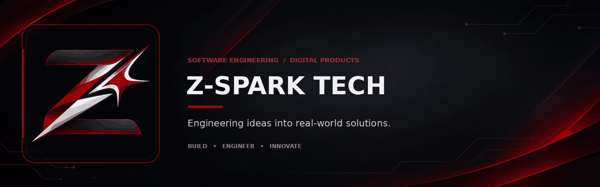

  <!-- Official Organization Animated Banner -->
  

    

  

    <strong>SOFTWARE ENGINEERING &nbsp;·&nbsp; DIGITAL PRODUCTS &nbsp;·&nbsp; ENTERPRISE SYSTEMS</strong>
  

  

    <em>Think Beyond. Build Better. Spark Innovation.</em>
  

  

    
    &nbsp;
    
  

---

## About Z-Spark Tech

**Z-Spark Tech** is a software engineering and technology organization based in Egypt. We design, develop, and maintain digital products and software systems that address real-world operational challenges.

Our focus extends beyond writing code. We believe in understanding core domain problems, architecting robust systems, delivering dependable software, and continuously advancing our engineering capabilities.

## Our Mission

> To transform ideas and real-world challenges into reliable digital solutions through collaborative engineering, innovation, and continuous development.

## Our Vision

> To become a recognized technology organization known for building meaningful software products, engineering reliable systems, and creating lasting value through technology.

---

## What We Do

Our engineering capabilities span across key software development disciplines:

- **Web Application Development:** Modern, responsive, and scalable web applications engineered with component-based frameworks and clean design systems.
- **Backend Engineering & API Development:** High-throughput, maintainable backend services, RESTful APIs, and relational data architecture built on ASP.NET Core and .NET.
- **Mobile Application Development:** Practical, responsive mobile experiences built with cross-platform frameworks including Flutter.
- **Enterprise & Management Systems:** Operational dashboards, administrative tools, and automated workflows that streamline organizational processes.
- **Education Technology:** Academic software solutions, including admissions portals, computer-based exam hubs, attendance systems, and competency platforms.
- **Authentication & System Integration:** Centralized Single Sign-On (SSO) gateways and token-based authentication services providing unified identity across platforms.
- **Software Infrastructure & Deployment:** Deployment automation, database lifecycle management, containerization with Docker, and CI/CD workflows.

---

## Project Showcase

We build software across education, enterprise operations, digital products, and developer-focused platforms. Our projects address practical organizational challenges through carefully engineered applications, integrated systems, and intuitive digital experiences.

### 1. Education & Academic Technology

<strong>Capstone</strong> — Academic Project Management System

 

A centralized academic project management platform designed to organize and manage the capstone project lifecycle, connecting students, teams, supervisors, and engineering staff.

**Key Capabilities**
- Manage project teams and their members.
- Assign tasks, track deadlines, and monitor project progress.
- Submit project work and support review and resubmission workflows.
- Generate reports and provide visibility into project activity.

**Technology:** React 18, Tailwind CSS, Chart.js, ASP.NET Core 8 Web API, Entity Framework Core, SQL Server, JWT Authentication.

<strong>GenZCoders</strong> — Learning Management System

 

An educational platform designed to organize learning programs, courses, rounds, and learning materials in one environment.

**Key Capabilities**
- Organize courses and their associated learning rounds.
- Structure learning content through weeks and curriculum materials.
- Support multiple material formats, including PDFs, videos, presentations, and online meeting links.
- Manage course-related workflows and payment proof submissions.
- Support local file storage for uploaded materials.

**Technology:** React, Vite, Material UI, Tailwind CSS, ASP.NET Core Web API, Entity Framework Core, SQL Server.

<strong>Elsewedy Portfolio</strong> — Educational Institution Website

 

A public-facing portfolio website representing ElSewedy International Applied Technology and Software School, providing an organized digital presence for the institution.

**Key Capabilities**
- Present the institution's identity and educational profile.
- Organize institutional information and educational content.
- Provide visitors with a modern and responsive browsing experience.
- Showcase the institution through a consistent visual design.

**Technology:** React, Vite, Tailwind CSS, Cairo and Inter typography.

<strong>Attendance</strong> — Student Attendance Management System

 

A school attendance management platform designed to record and monitor student attendance and provide organized attendance information for school operations.

**Key Capabilities**
- Maintain student attendance records.
- Track attendance and absence information.
- Provide attendance logs and reporting capabilities.
- Support school attendance workflows through a responsive web application.

**Technology:** React, Vite, ASP.NET Core 8 Web API, Entity Framework Core, SQL Server, Firebase Admin SDK, Progressive Web App (PWA).

<strong>Admission-System</strong> — School Admission Platform

 

A digital admission system designed to manage the student application process and support online admission assessments.

**Key Capabilities**
- Manage student registration and admission applications.
- Organize and monitor applicant information and admission statuses.
- Support timed online admission examinations.
- Provide access to admission results and administrative workflows.
- Support role-based administrative operations.

**Technology:** React 19, Vite, Tailwind CSS 4, Recharts, ASP.NET Core 8 Web API, Entity Framework Core, SQL Server.

<strong>Exam-Hub</strong> — Online Examination Platform

 

An online examination platform built to support examination management, question organization, student exam sessions, and results within an integrated educational environment.

**Key Capabilities**
- Organize examination questions and question-bank data.
- Manage examination-related workflows.
- Support student examination sessions and submissions.
- Process and organize examination results.
- Integrate with centralized authentication services.

**Technology:** React, Vite, ASP.NET Core .NET 9 Web API, Entity Framework Core, SQL Server, ClosedXML, CAS Single Sign-On.

<strong>Assessment</strong> — Digital Assessment Platform

 

A modern digital assessment platform designed to support the organization and delivery of academic assessments through a web-based application.

**Key Capabilities**
- Provide a structured environment for assessment-related workflows.
- Support assessment management and administration.
- Deliver modern, responsive user interfaces.
- Organize assessment information and related academic operations.

**Technology:** Next.js 16, React 19, Radix UI, ASP.NET Core .NET 10, Entity Framework Core 10, SQL Server.

<strong>SUE</strong> — Student Union Election System

 

A digital student union election platform designed to organize election activities and support the student voting process.

**Key Capabilities**
- Support student union election workflows.
- Organize election-related information.
- Provide real-time communication and updates.
- Support secure application authentication and data management.
- Facilitate the management of election activities.

**Technology:** React 18, Vite, ASP.NET Core 8 Web API, SignalR, Entity Framework Core, SQL Server, BCrypt.

 

### 2. Enterprise & Operational Systems

<strong>AdminHub</strong> — Administrative Management Platform

 

A centralized administrative platform designed to simplify and organize school management operations through a unified dashboard.

**Key Capabilities**
- Manage student information and student accounts.
- Organize classes and student transfers.
- Manage admissions and administrative records.
- Support account and role management.
- Manage teams and related administrative workflows.
- Support bulk student data operations through Excel.

**Technology:** React, Vite, CSS Design System, ASP.NET Core 8 Web API, Entity Framework Core, SQL Server, ClosedXML.

<strong>Employee Attendance</strong> — Employee Operations System

 

An employee operations platform associated with the organization's RMS environment, supporting employee-related administrative workflows and leave management.

**Key Capabilities**
- Organize employee-related operational information.
- Support employee leave-management workflows.
- Provide an administrative web interface.
- Connect employee operations with centralized backend services.

**Technology:** React, Vite, Tailwind CSS, ASP.NET Core Web API, Entity Framework Core, SQL Server.

<strong>TicTrack</strong> — IT Command & Ticket Management System

 

An IT command and management platform designed to organize technical support operations and provide visibility into IT requests and their progress.

**Key Capabilities**
- Centralize IT-related requests and operational activities.
- Support ticket and request tracking.
- Organize technical support workflows.
- Provide an operational dashboard for monitoring activities.
- Connect the web interface with backend services.

**Technology:** Next.js App Router, React, Tailwind CSS, ASP.NET Core 9 Web API, Entity Framework Core.

<strong>CAS-Login</strong> — Central Authentication Service

 

A centralized authentication platform designed to provide a shared authentication foundation for multiple organizational applications.

**Key Capabilities**
- Centralize user authentication.
- Support Single Sign-On integration across connected systems.
- Manage accounts and role-based access.
- Provide authentication services for integrated applications.
- Reduce the need for separate authentication implementations across systems.

**Technology:** React, Vite, ASP.NET Core Web API, Entity Framework Core, SQL Server, JWT Bearer Authentication, BCrypt.

 

### 3. Products & Digital Experiences

<strong>Al-Qady</strong> — Online Programming Judge

 

A programming and automated judging platform designed to support coding problems, programming submissions, and automated evaluation through an integrated judging environment.

**Key Capabilities**
- Organize programming problems and their test cases.
- Support programming submission and evaluation workflows.
- Integrate with the DMOJ judging engine.
- Process test cases and return judging results.
- Support multiple programming languages through the judging infrastructure.
- Connect judging operations with dedicated device-side services.

**Technology:** ASP.NET Core 8, React 19, TypeScript, SQL Server, Debian-based DMOJ Judge Adapter, .NET 8 Device Agent.

<strong>UI Gallery</strong> — Interactive UI Components & Data Experiences

 

A frontend-focused project showcasing modern interface development, interactive components, and data-intensive user interface experiences.

**Key Capabilities**
- Present interactive frontend interface elements.
- Explore advanced data grids and table experiences.
- Support flexible table layouts and data presentation.
- Demonstrate drag-and-drop interactions.
- Provide animated and responsive user experiences.

**Technology:** Next.js 16, React 19, TypeScript, Tailwind CSS 4, AG Grid, TanStack Table, dnd-kit, Framer Motion.

<strong>Z-Spark Portfolio</strong> — Company Portfolio Website

 

The digital portfolio of Z-Spark Tech, designed to represent the organization's identity, software engineering capabilities, and digital work.

**Key Capabilities**
- Present the organization's identity and professional profile.
- Showcase software engineering services and capabilities.
- Organize project and portfolio information.
- Provide a modern, responsive digital experience.
- Maintain a consistent visual identity through motion and interface design.

**Technology:** Next.js 16, React 19, TypeScript, Tailwind CSS 4, Motion, Lucide Icons.

---

## Technology Ecosystem

Our development work centers around verified, modern technologies:

- **Backend:** C#, .NET, ASP.NET Core, REST APIs, Entity Framework Core.
- **Frontend:** React, Next.js, Angular, TypeScript, JavaScript, Vite, Tailwind CSS.
- **Mobile:** Flutter.
- **Databases:** Microsoft SQL Server and relational database technologies.
- **Tools & Infrastructure:** Docker, Git, GitHub Actions, CI/CD, IIS.

---

## Engineering Principles

- **Clean and maintainable code:** Writing clear, well-structured, and readable code designed for long-term maintainability.
- **Scalable and well-structured architecture:** Establishing modular architectures with strict separation of concerns across application layers.
- **Security-conscious development:** Enforcing strict authentication, role-based access control, cryptographic password hashing, and input validation across systems.
- **Data integrity and reliability:** Protecting relational consistency through schema constraints, structured database migrations, and transactional boundaries.
- **Testing and validation:** Systematically validating functionality, data flows, and edge cases prior to deployment.
- **Collaboration and knowledge sharing:** Fostering shared codebase ownership, constructive peer reviews, and collaborative problem-solving.
- **Continuous improvement:** Continuously evolving technical standards and modernizing tooling to match changing organizational needs.

---

## Development Lifecycle

We follow a structured six-stage development process to deliver consistent and dependable software:

1. **Understand the problem:** Analyze operational requirements and identify root user and institutional challenges.
2. **Plan and design the solution:** Define data models, application architecture, API contracts, and user workflows.
3. **Engineer and implement:** Develop robust frontend and backend solutions following clean coding practices.
4. **Test and validate:** Verify functionality, data validation rules, and system behavior across user roles.
5. **Deploy and monitor:** Publish systems through reliable hosting pipelines and monitor operational health.
6. **Maintain and improve:** Iterate on user feedback, optimize system performance, and introduce refinements over time.

---

## Protecting Our Work

Z-Spark Tech develops and maintains proprietary software systems. Source repositories and internal implementation details remain private to protect organizational intellectual property, security, and operational integrity.

Our public profile showcases our capabilities, engineering disciplines, and project summaries without exposing private source code, internal endpoints, or confidential implementation details.

---

## Official Links & Contact

- **Official Website:** [https://zspark.sewedy.com.eg/](https://zspark.sewedy.com.eg/)
- **GitHub Organization:** [https://github.com/Z-Spark-Tech](https://github.com/Z-Spark-Tech)

---

   

  <h3>⚡ Think Beyond. Build Better. Spark Innovation. ⚡</h3>

  

    <em>Engineering dependable digital solutions, integrated systems, and modern software architectures.</em>
  

   

  © Z-Spark Tech · Software Engineering & Technology Organization · Egypt

